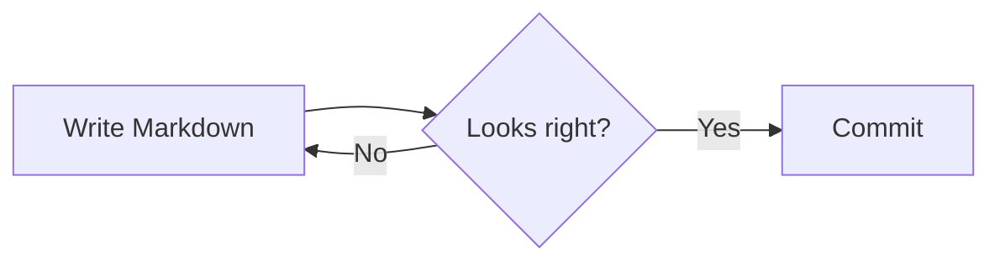
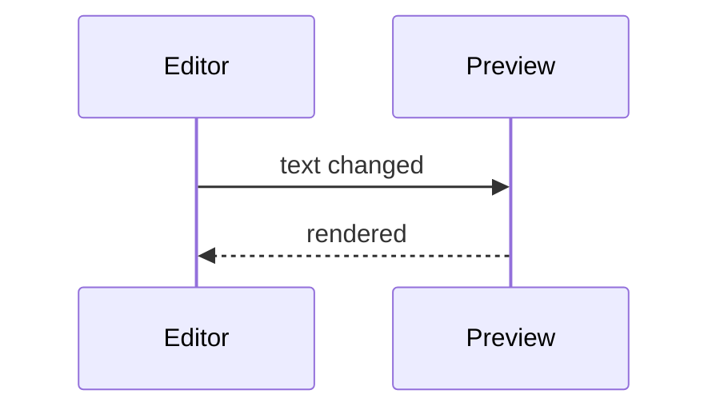
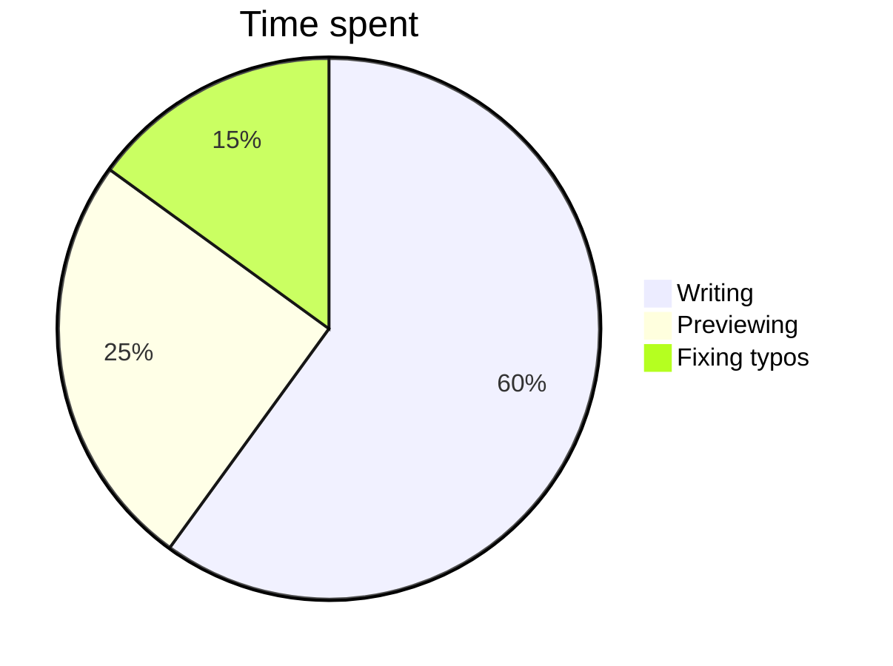

# Markdown Feature Tour

This document exercises everything GitHub's Markdown preview supports. Edit it on the left and the preview on the right updates as you type.


## Contents

- [Text formatting](#text-formatting)
- [Lists](#lists)
- [Code](#code)
- [Tables](#tables)
- [Alerts](#alerts)
- [Math](#math)
- [Diagrams](#diagrams)
- [Maps and 3D models](#maps-and-3d-models)
- [HTML](#html)

## Text formatting

**Bold**, *italic*, ***bold italic***, ~~strikethrough~~, `inline code`, <sub>subscript</sub>, <sup>superscript</sup>, <ins>underline</ins> and <kbd>⌘</kbd> + <kbd>S</kbd>.

Emoji shortcodes work too :rocket: :sparkles: :+1: :tada:

Autolinks: https://github.com, www.apple.com and hello@example.com. A [regular link](https://docs.github.com/en/get-started/writing-on-github) and a [link to a heading](#tables).

> Blockquotes can contain **formatting**
>
> > and can be nested.

A line ending with two spaces  
continues on the next line, and so does one ending with a backslash\
like this.

---

## Lists

1. First item
2. Second item
   - Nested bullet
   - Another one
     1. Deeply nested number
3. Third item

- [x] Completed task
- [ ] Open task
- [ ] Task with `code` and **bold**

## Code

Inline `const x = 1` and fenced blocks with syntax highlighting:

```swift
import SwiftUI

struct ContentView: View {
    @State private var count = 0

    var body: some View {
        Button("Tapped \(count) times") { count += 1 }
            .buttonStyle(.glass)
    }
}
```

```typescript
interface User {
  id: number;
  name: string;
}

export async function load(id: number): Promise<User> {
  const res = await fetch(`/api/users/${id}`);
  return res.json();
}
```

```diff
- removed line
+ added line
  unchanged line
```

```
Plain fenced block with no language.
```

    Indented code block.

## Tables

| Feature        | Supported | Notes                      |
| :------------- | :-------: | -------------------------: |
| Tables         | ✅        | with column alignment      |
| `inline code`  | ✅        | inside cells               |
| **Formatting** | ✅        | [links](#tables) too       |

## Alerts

> [!NOTE]
> Useful information that users should know, even when skimming content.

> [!TIP]
> Helpful advice for doing things better or more easily.

> [!IMPORTANT]
> Key information users need to know to achieve their goal.

> [!WARNING]
> Urgent info that needs immediate user attention to avoid problems.

> [!CAUTION]
> Advises about risks or negative outcomes of certain actions.

## Math

Inline math like $E = mc^2$ and $`\sqrt{x^2 + y^2}`$ sits within text. Prices like $5 and $10 stay as text.

$$
\int_{-\infty}^{\infty} e^{-x^2}\,dx = \sqrt{\pi}
$$

```math
\begin{aligned}
\nabla \cdot \mathbf{E} &= \frac{\rho}{\varepsilon_0} \\
\nabla \times \mathbf{B} &= \mu_0 \mathbf{J} + \mu_0 \varepsilon_0 \frac{\partial \mathbf{E}}{\partial t}
\end{aligned}
```

## Diagrams







## Maps and 3D models

```geojson
{
  "type": "FeatureCollection",
  "features": [
    {
      "type": "Feature",
      "properties": { "name": "Apple Park" },
      "geometry": { "type": "Point", "coordinates": [-122.0090, 37.3349] }
    },
    {
      "type": "Feature",
      "properties": { "name": "Route" },
      "geometry": {
        "type": "LineString",
        "coordinates": [[-122.0090, 37.3349], [-122.0322, 37.3230], [-122.0839, 37.3861]]
      }
    }
  ]
}
```

```stl
solid pyramid
  facet normal 0 -0.707 0.707
    outer loop
      vertex -1 -1 0
      vertex 1 -1 0
      vertex 0 0 1.5
    endloop
  endfacet
  facet normal 0.707 0 0.707
    outer loop
      vertex 1 -1 0
      vertex 1 1 0
      vertex 0 0 1.5
    endloop
  endfacet
  facet normal 0 0.707 0.707
    outer loop
      vertex 1 1 0
      vertex -1 1 0
      vertex 0 0 1.5
    endloop
  endfacet
  facet normal -0.707 0 0.707
    outer loop
      vertex -1 1 0
      vertex -1 -1 0
      vertex 0 0 1.5
    endloop
  endfacet
  facet normal 0 0 -1
    outer loop
      vertex -1 -1 0
      vertex 1 1 0
      vertex 1 -1 0
    endloop
  endfacet
  facet normal 0 0 -1
    outer loop
      vertex -1 -1 0
      vertex -1 1 0
      vertex 1 1 0
    endloop
  endfacet
endsolid pyramid
```

## HTML

<details>
<summary>Click to expand</summary>

Hidden content with **Markdown** inside.

</details>

<p align="center">Centered paragraph using the <code>align</code> attribute.</p>

<picture>
  <source media="(prefers-color-scheme: dark)" srcset="https://placehold.co/300x60/0d1117/ffffff?text=Dark+mode">
  
</picture>

<span style="color: red">Inline styles are stripped, just like on GitHub.</span>

## Footnotes

Here is a simple footnote[^1]. And here is a longer one[^note].

[^1]: My reference.
[^note]: Footnotes can have **formatting**
    and span multiple lines.
