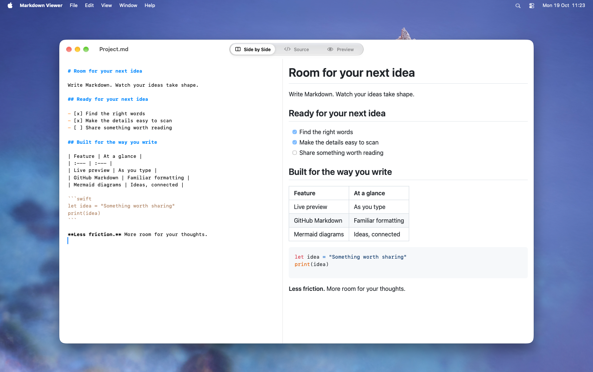
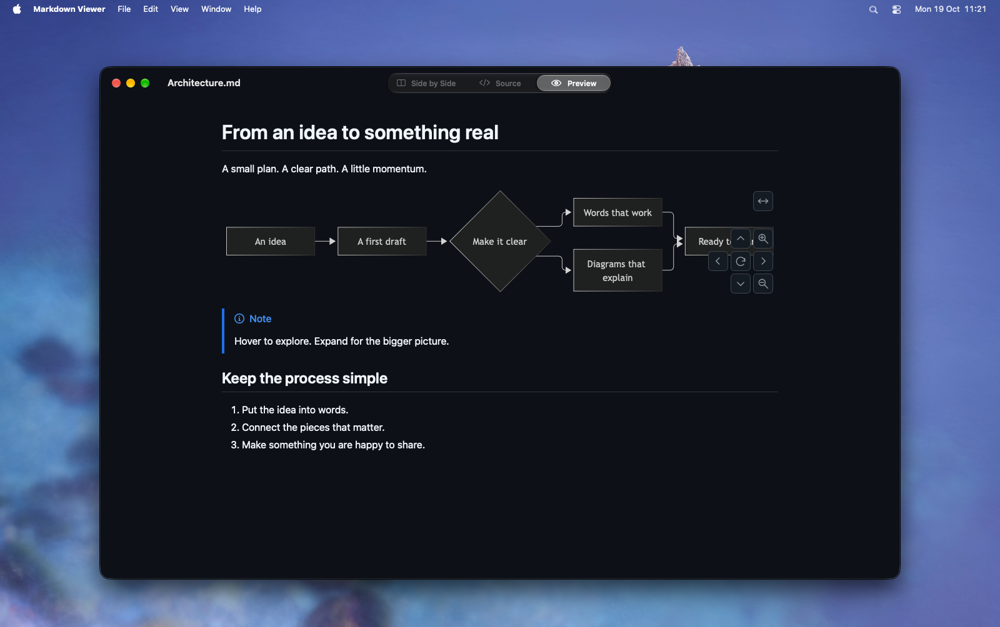
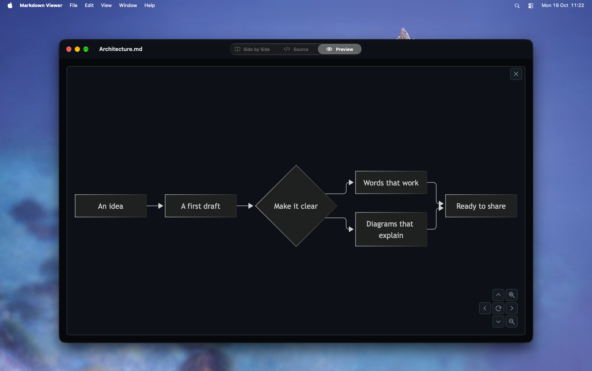

<div align="center">

# Markdown Viewer

**A native macOS app for writing Markdown and seeing it come to life.**

GitHub-style previews. A self-saving scratch pad. A little more room for your ideas.

**macOS 26+** · **SwiftUI** · **Liquid Glass**

</div>

<picture>
  <source media="(prefers-color-scheme: dark)" srcset="docs/screenshots/dark-writing.png">
  <source media="(prefers-color-scheme: light)" srcset="docs/screenshots/light-overview.png">
  
</picture>

## Write, preview, keep going

Start in the **Scratch Pad** and write immediately. It saves itself, including when you quit. Open a file when you need one, or use **Save as File…** to turn your scratch text into a Markdown document.

Switch between **Side by Side**, **Source**, and **Preview**. Your editor, undo history, and preview stay alive as you switch, and the split view keeps scrolling in sync.

- **Familiar rendering.** GitHub-style typography, syntax highlighting, tables, task lists, alerts, footnotes, and emoji.
- **More than text.** Mermaid diagrams, mathematical notation, GeoJSON and TopoJSON maps, and ASCII STL models.
- **Made for macOS.** Light and dark appearance, native file windows, and a Liquid Glass view selector.
- **Comfortable with local files.** Images and links resolve relative to the Markdown document.

Opening a file replaces an empty Scratch Pad window. A scratch pad containing text stays open.

## Give your ideas a shape

Mermaid diagrams render directly in the preview. Hover to reveal the controls, pan or zoom to explore, and use the **↔** button to expand a diagram. Close the expanded view with **×** or **Escape**.



<details>
<summary><strong>See the expanded diagram</strong></summary>



</details>

## License

Copyright (c) 2026 sw-aka.

Markdown Viewer is free software licensed under the **GNU Affero General Public License, version 3 only** (`AGPL-3.0-only`). You may redistribute and modify it under those terms. It is distributed without any warranty, including the implied warranties of merchantability or fitness for a particular purpose. See [LICENSE](LICENSE) for the complete terms.

Third-party components retain their respective licenses.

## A few useful shortcuts

| Action | Shortcut |
| :--- | :--- |
| Scratch Pad | ⌘0 |
| Side by Side | ⌘1 |
| Source | ⌘2 |
| Preview | ⌘3 |
| Open a file | ⌘O |
| Close an expanded diagram | Escape |

Drag the divider to resize the panes. Double-click it to return to an even split.

For a tour of the supported Markdown features, choose **Help → Markdown Feature Tour**.

## Updates

Choose **Stable** or **Development** in **Settings → Updates**. The app checks on launch by default; you can turn that off and check manually with the circled up arrow in the toolbar.

When an update is available, choose **Update Now**. Download progress appears in the popover and around the toolbar icon while you keep writing. After the download is verified, the app saves your current session, installs the update, and restores your windows and unsaved text.

See [Releasing](RELEASING.md) for the branch flow, signing setup, and distribution details.

## Build and run

Requires **macOS 26 or later** and **Xcode with the macOS 26 SDK or later**. The generated Xcode project and bundled renderer are included, so building the app does not require Node.js. Fetch the pinned Sparkle framework once before building:

From the repository root:

```sh
scripts/bootstrap-sparkle.sh

xcodebuild \
  -project MarkdownViewer.xcodeproj \
  -scheme MarkdownViewer \
  -configuration Debug \
  -derivedDataPath build/DerivedData \
  build

open "build/DerivedData/Build/Products/Debug/Markdown Viewer.app"
```

To copy the built app into your Applications folder:

```sh
mkdir -p "$HOME/Applications"
ditto "build/DerivedData/Build/Products/Debug/Markdown Viewer.app" \
  "$HOME/Applications/Markdown Viewer.app"
open "$HOME/Applications/Markdown Viewer.app"
```

<details>
<summary><strong>Working on the renderer or Xcode project</strong></summary>

The app uses SwiftUI and a bundled WebKit preview. The renderer lives in [`renderer/`](renderer/) and uses markdown-it, DOMPurify, and GitHub's Markdown styles, with Mermaid and MathJax loaded when needed.

For renderer development, use **Node.js 26 or later** and npm:

```sh
cd renderer
npm ci
npm test
npm run build
```

The renderer build writes to `MarkdownViewer/Resources/Renderer`. Include those generated files with renderer source changes; Xcode does not run the JavaScript build.

[`project.yml`](project.yml) is the source of truth for the Xcode project. After changing the project specification or adding or removing Swift files, regenerate it with [XcodeGen](https://github.com/yonaskolb/XcodeGen):

```sh
xcodegen generate
```

See [`DEVELOPMENT.md`](DEVELOPMENT.md) for the project layout and development notes.

</details>
